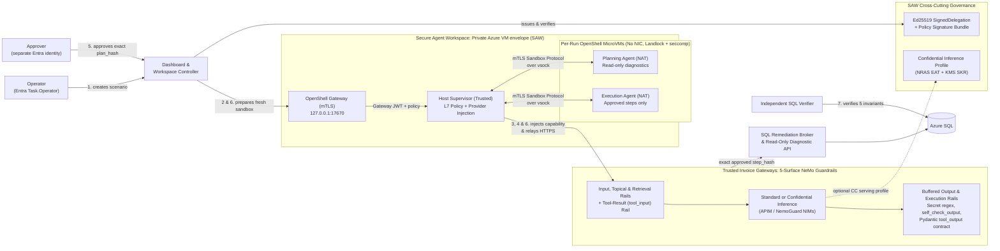

# LearningNeMo — Governed AI Agents on the NVIDIA Agent Stack

LearningNeMo runs NVIDIA NeMo agents against a production-like Azure system
and shows what it takes to let an agent do useful work **without giving it the
authority to cause harm**. The central question is not only "will the model
follow instructions?" but "what can the agent actually reach or change, even
when it does not follow instructions?"

The example workload is an invoice incident: a Planning agent investigates
and proposes a repair, a human approves the exact plan, an Execution agent
carries it out in a separate sandbox, and an independent verifier checks the
database. Each step is bounded by a different control.

## The NVIDIA stack

| Component | What it does here | Details |
| --- | --- | --- |
| **NeMo Agent Toolkit** | Every agent is a NAT workflow: an LLM, registered tools, security middleware, and correlated telemetry defined in YAML | [NeMo Agent Toolkit](docs/nvidia/nemo-agent-toolkit.md) |
| **NeMo Guardrails** | All 5 rail surfaces (input, topical, retrieval, tool-input/tool-output execution, and output) run in a trusted gateway the agent cannot bypass, scored by a 66-case evaluation set | [NeMo Guardrails](docs/nvidia/nemo-guardrails.md) |
| **OpenShell** | Each agent run gets its own MicroVM sandbox with Ed25519-signed policy, Landlock `hard_requirement`, Python-only L7 egress, and provider credential mediation | [OpenShell](docs/nvidia/openshell.md) |
| **Secure Agent Workspace** | NVIDIA's 3-layer reference design: private workspace perimeter, OpenShell runtime sandboxes, and Ed25519-signed delegation governance | [Secure Agent Workspace](docs/nvidia/secure-agent-workspace.md) |
| **Confidential Computing & KMS** | NRAS / `nvtrust` GPU (`GH100`/`GB200` `cc_mode=on`) + CVM (`amd-sev-snp`/`intel-tdx`) EAT verifier gating Partner KMS Secure Key Release (SKR) | [Confidential Computing](docs/nvidia/confidential-computing.md) |
| **ISV Solutions Blueprint** | Reference architecture mapping threat triage, NL-to-Query, RAG poisoning containment, and PoC-to-Production rollout for enterprise ISVs | [ISV Blueprint](docs/nvidia/isv-blueprint.md) |



The agent receives a model response only after every output and execution
rail passes in the buffered gateway. Each layer assumes the one inside it can
fail: the rails screen untrusted content and tool calls, the OpenShell MicroVM
limits what the agent process can touch or reach, the SAW perimeter limits what
the host VM can reach, Ed25519 signatures bind the policy and delegation
record, and the SQL broker enforces the exact human-approved plan hash.

See [Architecture](docs/architecture.md) for the full design, sequence diagram,
and trust boundaries.

## Status

This is a single-user proof of concept, not a production deployment. The
invoice workflow has run end to end with real Planning and Execution agents in
separate MicroVMs; several hardening changes are merged but not yet deployed,
and some reference-design layers are still gaps. [Status](docs/status.md) is
the single summary.

## Where to start

| Goal | Start with |
| --- | --- |
| Understand the design | [Architecture](docs/architecture.md), then the [NVIDIA component pages](docs/README.md#nvidia-components) |
| Run the task agent on your machine | [Local authorization walkthrough](docs/guides/local-authorization.md) |
| Build or operate the Azure environment | [Build and reproduce](docs/guides/build-and-reproduce.md) |
| Present it | [Presenter runbook](docs/guides/capability-demo.md) |
| Everything else | [Documentation index](docs/README.md) |

## Repository layout

| Path | Contents |
| --- | --- |
| [`src/task_agent/`](src/task_agent/README.md) | Agents, tools, security middleware, trusted services, and the dashboard |
| [`configs/`](configs) | NeMo Agent Toolkit workflow definitions |
| [`infra/next-phase/`](infra/next-phase/README.md) | Azure infrastructure, workspace VM, OpenShell policies and provider profiles |
| [`containers/`](containers/README.md) | Container images and their supply-chain evidence |
| [`docs/`](docs/README.md) | Architecture, NVIDIA component pages, guides, decisions, and dated records |
| [`tests/`](tests) | Python and browser tests |

## Validate locally

```bash
export UV_PROJECT_ENVIRONMENT="$HOME/.venvs/nemo-agents"
uv sync --frozen
"$UV_PROJECT_ENVIRONMENT/bin/python" -m pytest -q
"$UV_PROJECT_ENVIRONMENT/bin/python" scripts/validate-agent-config.py
"$UV_PROJECT_ENVIRONMENT/bin/python" scripts/evaluate-guardrails.py
bash infra/test-all-local.sh
```

These make no model calls and do not query or change Azure. The same checks,
plus the browser tests, run on every pull request in
[CI](.github/workflows/ci.yml).
