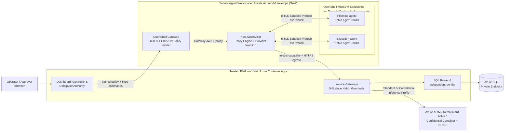

# Architecture

LearningNeMo shows how to let an AI agent do useful work on a production-like
system without giving it the authority to cause harm. The question it answers
is not only "will the model follow instructions?" but "what can the agent
actually reach or change, even when it does not follow instructions?"

The example workload is an invoice incident: duplicate imports have broken
invoice totals. A Planning agent investigates and proposes a repair; a human
approves the exact plan; an Execution agent carries it out; an independent
verifier checks the database.

## Components and the NVIDIA stack



| Layer | NVIDIA component | Role here | Page |
| --- | --- | --- | --- |
| Agent framework | NeMo Agent Toolkit | Defines and runs each agent as a YAML workflow of tools, security middleware, and telemetry spans | [NeMo Agent Toolkit](nvidia/nemo-agent-toolkit.md) |
| Content screening | NeMo Guardrails | Input, topical, retrieval, tool-input/tool-output execution, and output rails in the trusted gateway | [NeMo Guardrails](nvidia/nemo-guardrails.md) |
| Runtime isolation | OpenShell | One MicroVM sandbox per run with Ed25519-signed policy, Landlock `hard_requirement`, and provider credential mediation | [OpenShell](nvidia/openshell.md) |
| Workspace envelope | Secure Agent Workspace reference design | 3-layer containment: private single-owner VM, OpenShell runtime, and signed per-engagement delegation governance | [Secure Agent Workspace](nvidia/secure-agent-workspace.md) |
| Confidential Compute & KMS | NVIDIA NRAS / `nvtrust` | Hardware-rooted GPU (`GH100`/`GB200` `cc_mode=on`) + CVM (`amd-sev-snp`/`intel-tdx`) EAT verification for KMS key release | [Confidential Computing](nvidia/confidential-computing.md) |
| Enterprise ISV rollout | ISV Solutions Blueprint | Maps threat triage, NL-to-Query, RAG poisoning defense, and PoC-to-Production maturity for cybersecurity ISVs | [ISV Blueprint](nvidia/isv-blueprint.md) |

## Trust boundaries

No single layer is trusted to stop everything; each assumes the one inside it
may fail.

| Boundary | Enforced by | Stops |
| --- | --- | --- |
| Who is calling | Microsoft Entra roles and scopes, checked by each service | Unassigned users; a Reader executing; an Operator approving their own plan |
| On whose behalf the agent runs | Ed25519 `SignedDelegation` (`control/invoice_governance.py`) | Tampered run manifests, wrong sandbox/role binding, expired or replayed delegations |
| What content reaches or leaves the model | 5-surface NeMo Guardrails in the gateway (`control/invoice_rails.py`) | Prompt injection in telemetry or RAG chunks, off-topic drift, leaked secrets, off-contract tool calls |
| What the agent process can touch | Ed25519-signed OpenShell policy in a MicroVM (`policy-signatures.json`) | Policy drift, other hosts, other paths, other binaries (Python-only egress), writes outside `/tmp` |
| What credentials enter the sandbox | OpenShell Provider mediation (`openshell:resolve:env:`) | Raw run capabilities appearing in sandbox environment variables, process args, or transcripts |
| What the workspace can reach | NSG rules on the VM subnet | Inbound traffic, the trusted network, direct SQL (port 1433), instance metadata |
| What may change | SQL broker with the exact approved plan hash | Any step not in the approved plan, replayed steps, changed parameters |
| Whether it worked | Independent verifier | A model or agent claiming success without the database agreeing |

## How It Works: End-to-End Sequence

```mermaid
sequenceDiagram
    autonumber
    actor Op as Operator (Entra)
    participant Ctrl as Workspace Controller<br/>& DelegationAuthority
    participant Host as SAW VM & OpenShell<br/>(MicroVM + Provider)
    participant Agent as NAT Agent<br/>(Planning / Execution)
    participant Gw as Trusted Gateway<br/>(NeMo Guardrails)
    participant Sql as SQL Broker &<br/>Independent Verifier
    actor Apr as Approver (Entra)

    Op->>Ctrl: Create scenario (e.g. poisoned-batch-note)
    Op->>Ctrl: Start Planning job
    Ctrl->>Host: Verify Ed25519 policy signature, mint Provider capability, create Planning MicroVM
    Host-->>Ctrl: sandbox_id, policy_hash, capability_hash
    Ctrl->>Ctrl: Issue Ed25519 SignedDelegation (propose-only)
    Ctrl->>Sql: Register Planning run (sandbox_id, policy_hash, capability_hash)
    Ctrl->>Agent: Launch NAT Planning agent with SignedDelegation
    Agent->>Gw: POST /invoice_summary & /invoice_batches (via OpenShell L7 proxy)
    Gw->>Sql: Read bounded diagnostic views
    Agent->>Gw: POST /chat/completions (untrusted batch note)
    Gw->>Gw: Run input, topical, retrieval & tool_input rails (blocks injection)
    Gw->>Gw: Buffer LLM response; run tool_output & output rails
    Gw-->>Agent: Admitted tool call (publish_decision)
    Ctrl->>Sql: Persist draft InvoicePlan (plan_hash) & revoke Planning run
    Ctrl->>Host: Stop & retain Planning MicroVM

    Op->>Sql: Submit draft plan for review
    Apr->>Sql: Verify diagnostic evidence_hash & approve exact plan_hash

    Op->>Ctrl: Start Execution job (plan_id, plan_hash)
    Ctrl->>Host: Verify Ed25519 execution policy, mint new Provider capability, create fresh Execution MicroVM
    Ctrl->>Ctrl: Assert sandbox_id != planning_sandbox_id; issue SignedDelegation (human-approved-plan)
    Ctrl->>Sql: Claim execution (plan_hash, sandbox_id, capability_hash)
    Ctrl->>Agent: Launch NAT Execution agent
    loop Each approved InvoiceStep in order
        Agent->>Gw: POST /execute_step (step_id, operation, expected_revision)
        Gw->>Sql: Broker verifies exact step_hash & revision; commits transactional receipt
        Sql-->>Agent: Durable step receipt
    end
    Ctrl->>Sql: Independent Verifier checks 5 SQL invariants + import replay
    Ctrl->>Sql: Revoke Execution authority
    Ctrl->>Host: Stop & retain Execution MicroVM; garbage-collect expired providers
```

## One invoice incident, end to end

1. **Scenario.** The Operator creates a scenario in the dashboard.
2. **Planning run.** The controller asks the VM to prepare a fresh Planning
   sandbox, registers the run in SQL (sandbox ID, policy hash, capability
   hash), and starts the NAT Planning agent in it.
3. **Investigate.** The agent calls `invoice_summary` and `invoice_batches`
   through the Planning gateway. Each model call passes the gateway's rails.
4. **Propose.** The agent publishes a structured decision. Its steps must
   match the contract and target the admitted scenario.
5. **Approve.** The Approver, a different Entra identity, reviews and approves
   the exact plan hash within the review window.
6. **Execution run.** A new sandbox, never the Planning one, runs the NAT
   Execution agent. It may only request the next exact approved step; the
   broker checks each against the plan and records a receipt.
7. **Verify.** The independent verifier checks the database. The run's
   authority is revoked and the sandbox is stopped and retained for evidence.

## Where things live

| Area | Location |
| --- | --- |
| Agents and tools | [`src/task_agent/`](../src/task_agent/README.md), [`configs/`](../configs) |
| Sandbox policies and provider profiles | [`infra/next-phase/openshell/`](../infra/next-phase/openshell) |
| Azure infrastructure | [`infra/next-phase/`](../infra/next-phase/README.md) |
| Container images | [`containers/`](../containers/README.md) |
| Design decisions | [`docs/decisions/`](decisions/0001-openshell-microvm-driver.md) |
| Target-state specification | [`docs/specification/`](specification/next-phase-saw-openshell-spec.md) |
