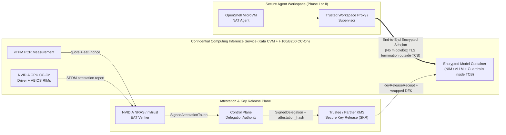

# NVIDIA Confidential Computing & Attestation-Bound Key Release

[NVIDIA Confidential Computing](https://www.nvidia.com/en-us/data-center/solutions/confidential-computing/)
extends hardware-rooted memory encryption and attestation from the host CPU
Trusted Execution Environment (AMD SEV-SNP or Intel TDX) across PCIe/NVLink to
NVIDIA Hopper (`GH100`) and Blackwell (`GB200`) GPUs. For enterprise ISVs
handling regulated data, proprietary model weights, or sensitive cybersecurity
telemetry, Confidential Computing ensures that neither the cloud provider nor a
compromised host hypervisor can inspect prompts, RAG context, or model weights
in cleartext.

| | |
| --- | --- |
| Implementation | [`src/task_agent/control/confidential_compute.py`](../../src/task_agent/control/confidential_compute.py) |
| Delegation binding | `DelegationRecord.attestation_hash` in [`src/task_agent/control/invoice_governance.py`](../../src/task_agent/control/invoice_governance.py) |
| Tests | [`tests/test_confidential_compute.py`](../../tests/test_confidential_compute.py) |

## Architecture: Confidential Inference Profile (NRAS + Trustee / KMS SKR)

Per NVIDIA's [Confidential Computing as an Additive Inference Serving Profile](https://docs.nvidia.com/enterprise-reference-architectures/secure-agent-workspace-reference-design/latest/confidential-computing-inference-profile.html),
confidential inference and a confidential workspace are separate decisions:
either a Phase I or Phase II Secure Agent Workspace can route sensitive requests
to a **Confidential Computing Inference Service** (a Kata Confidential VM +
CPU TEE + NVIDIA H100/B200 in `cc_mode=on`).

**Critical TLS Termination Invariant:** When inference-data confidentiality is
claimed, protection must extend from the trusted workspace-side client/proxy
into the attested inference enclave. An intermediate gateway, firewall, or DPU
outside the declared Trusted Computing Base (TCB) **must not terminate TLS or
decrypt protected prompt/response payloads**.

## What `confidential_compute.py` Enforces

`verify_attestation_token()` validates an Ed25519-signed Entity Attestation
Token (`SignedAttestationToken`) modeled on **NVIDIA Remote Attestation Service
(NRAS)** and **nvtrust** before any workload capability or decryption key is
released:

1. **Trusted Verifier Issuer (`iss`)**: Accepts only allowlisted attestation
   authorities (`https://nras.attestation.nvidia.com` for cloud-connected
   deployments or `https://nvtrust.local.internal` for air-gapped verifiers).
2. **Freshness & Anti-Replay (`eat_nonce`, `issued_at`, `expires_at`)**:
   Requires an exact match on the control plane's 256-bit challenge nonce and
   enforces a maximum token lifetime of 300 seconds.
3. **GPU Confidential Compute Posture**:
   - `x_nvidia_gpu_arch` in `('GH100', 'GB200')` and `x_nvidia_gpu_arch_check == True`
   - `x_nvidia_gpu_cc_mode == 'on'` (fails closed on `'off'` or `'devtools'`)
   - `x_nvidia_gpu_measurements_matching == True` against NVIDIA's signed
     Reference Integrity Manifests (`x_nvidia_gpu_driver_rim_id`,
     `x_nvidia_gpu_vbios_rim_id`)
4. **Confidential VM Host Posture**:
   - `host_tee_type` in `('amd-sev-snp', 'intel-tdx')`
   - `host_secure_boot == True` and `host_debug_disabled == True`
   - `vtpm_pcr_sha256` matched against the KMS policy's golden boot measurement
     allowlist.

## Partner KMS Integration (`evaluate_kms_key_release`)

Enterprise ISVs keep tenant data encryption keys (DEKs) and fine-tuned model
adapter keys in a partner KMS or HSM (Azure Key Vault Managed HSM, AWS KMS,
Fortanix DSM, or HashiCorp Vault). `evaluate_kms_key_release()` enforces a
dual-custody contract before releasing a wrapped key:

- The hardware environment must pass `verify_attestation_token()` and match the
  `KmsKeyReleasePolicy` allowlists (GPU architecture, host TEE type, and vTPM
  PCR digest).
- The control plane's `SignedDelegation` must be valid, unrevoked, scoped to
  the same `workspace_id`, and cryptographically bound to the exact
  `attestation_hash`.

## Relationship to the Live Demo

The live Azure demo runs on a `Standard_D2s_v5` Trusted Launch VM (vTPM +
Secure Boot without a physical H100/B200 GPU) to keep cloud costs near zero.
The NRAS verifier and KMS key-release policy in
[`src/task_agent/control/confidential_compute.py`](../../src/task_agent/control/confidential_compute.py)
provide the drop-in verification contract for moving the same OpenShell +
`SignedDelegation` architecture onto Confidential GPU instances (`Standard_NCC40ads_H100_v5`).
